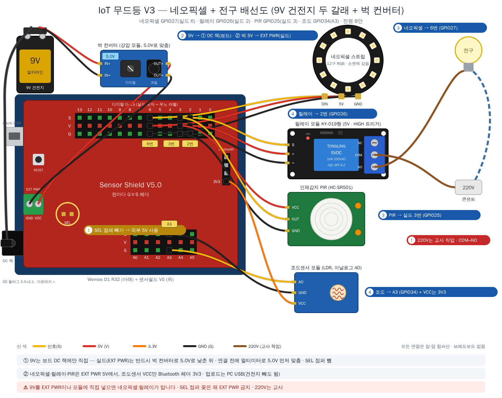
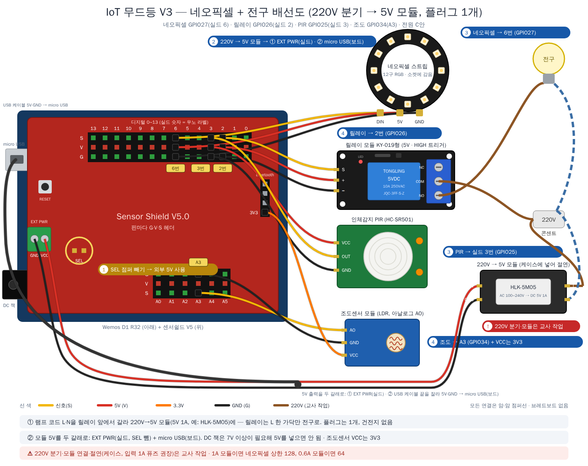

# V3 배선 — 네오픽셀 + 릴레이 전구 (Wemos D1 R32 + 센서쉴드 V5)

V1의 네오픽셀과 V2의 릴레이를 **한 실드에 같이** 꽂습니다. 센서 자리는 그대로입니다.

## ⚠️ 가장 중요한 것 둘

1. **220V 배선(전구 ↔ 릴레이)은 교사가 직접** 합니다. 학생은 실드 쪽까지만. 전구는 **COM–NO**에 (NC에 꽂으면 반대로 동작).
2. **SEL 점퍼를 꽂은 채 EXT PWR에 아무것도 연결하지 않습니다.** V3는 모든 5V를 보드에서 받습니다.

## 실드 쪽 배선 (학생 작업) — SEL 점퍼 꽂음

| 부품 | 실드 자리 | 부품 핀 → 헤더 | 비고 |
|---|:---:|---|---|
| 네오픽셀 **12구** | **6번** (GPIO27) | DIN → S · 5V → V · GND → G | 화살표 쪽이 DIN. 코드 `LED_COUNT 12` (V1 스트립은 16) |
| 릴레이 (KY-019형) | **2번** (GPIO26) | S → S · + → V · − → G | 3핀 나란히. HIGH 트리거 → `RELAY_ACTIVE_LOW = false` |
| 인체감지(PIR) | **3번** (GPIO25) | OUT → S · VCC → V · GND → G | |
| 조도센서 | **A3** (GPIO34) + Bluetooth 헤더 **3V3** | AO → S · GND → G · **VCC → 3V3** | |



## 전원 — 보드는 9V 건전지, 전구는 220V

두 가지 방법이 있습니다. **A안**은 부품이 더 필요 없고, **B안**은 벅 컨버터 하나를 더 쓰는 대신 네오픽셀을 더 밝게 켤 수 있습니다 (위 그림은 B안).

| | A안 — 9V를 DC 잭에만 | B안 — 9V 두 갈래 + 벅 컨버터 (위 그림) | C안 — 220V 분기 → 5V 모듈 (아래 그림) |
|---|---|---|---|
| 연결 | 9V → DC 잭. **SEL 꽂음** → 보드 5V가 실드로 | 9V → ① DC 잭(보드) · ② **벅 컨버터 5.0V → EXT PWR**(실드). **SEL 뺌** | 램프 코드 L·N을 릴레이 앞에서 갈라 **220V→5V 모듈** → ① EXT PWR(실드) · ② micro USB(보드). **SEL 뺌** |
| 추가 부품 | 없음 | 강압 모듈 1개 (LM2596 · MP1584형, 5.0V로 맞춤) | AC-DC 모듈 1개 (HLK-5M05 5V 1A 등) + 케이스 + USB 케이블 |
| 네오픽셀 상한 | **64** (레귤레이터 발열 때문) | 128까지 | 1A 모듈 128 · 0.6A 모듈(HLK-PM01) 64 |
| 지속 | 건전지 1시간 남짓 | 건전지 40분 안팎(상한 128) | **제한 없음**, 플러그 1개, 건전지 없음 |
| 220V 작업 | 전구 쪽만 (교사) | 전구 쪽만 (교사) | 전구 + 모듈 분기 (교사) · 절연 케이스, 입력 1A 퓨즈 권장 |
| 업로드 중 (PC USB만) | 네오픽셀·릴레이도 켜짐 (보드 5V → 실드) | 실드 쪽은 **안 켜짐** — 벅 5V도 꽂아 둔다 | 실드 쪽은 **안 켜짐** — 모듈(220V)도 꽂아 둔다 |



C안에서 5V는 **micro USB**로 보드에 넣습니다. DC 잭은 레귤레이터 때문에 7V 이상이 필요해 5V를 넣으면 ESP32가 불안정합니다. USB 케이블 끝을 잘라 빨강(5V)·검정(GND)만 모듈 출력에 잇거나, micro USB 브레이크아웃 보드를 씁니다.

> **9V를 EXT PWR이나 모듈에 직접 넣으면 안 됩니다.** EXT PWR은 전압을 낮추지 않고 디지털 줄 V로 그대로 보내므로 네오픽셀(최대 5.3V)·릴레이(5V)가 탑니다. 실드로 가는 갈래에는 반드시 5V로 낮추는 모듈을 둡니다.
> 벅 컨버터는 연결하기 **전에** 다이얼을 돌려 멀티미터로 5.0V를 맞춥니다. 처음 상태는 다른 전압입니다.

### A안 연결

```
[9V 건전지] ──DC 잭(가운데 +)──▶ Wemos D1 R32 레귤레이터 ──▶ 5V ──▶ 실드 V (SEL 꽂음) ──▶ 네오픽셀 · 릴레이 코일 · PIR
                                                        ──▶ Bluetooth 헤더 3V3 ──▶ 조도센서
[220V 콘센트] ──램프 코드──▶ 릴레이 COM–NO ──▶ 전구                                     (교사 작업, V2 wiring.md 와 같음)
```

- DC 잭 플러그는 **5.5×2.1mm, 가운데가 +**. 9V 건전지 스냅 → DC 플러그 어댑터를 씁니다.
- 코드 업로드·테스트 중에는 **PC USB만** 연결합니다. 건전지와 PC USB를 동시에 꽂지 않습니다.

### A안에서 밝기를 낮춰야 하는 이유 (9V → 레귤레이터)

보드의 레귤레이터(AMS1117 계열)는 9V를 5V로 낮추면서 **차이(4V) × 전류**만큼 열을 냅니다. 방열판이 없어 약 1W(≈0.25A)가 한계입니다.

| 부하 | 전류 |
|---|---|
| ESP32 (와이파이 안 씀, 3단계) | 약 0.08A |
| 릴레이 코일 (켜져 있을 때) | 약 0.08A |
| PIR + 조도센서 | 0.01A 미만 |
| 네오픽셀 12구 · 웜화이트 · 상한 **64** | 약 0.11A |
| 네오픽셀 12구 · 웜화이트 · 상한 128 | 약 0.24A → **합계 0.4A, 레귤레이터 과열** |

→ V3 펌웨어는 `MAX_BRIGHTNESS = 64`가 기본값입니다 (합계 약 0.27A). 9V 알카라인 건전지(약 500mAh)는 이 전류로 **1시간 남짓**이라 **시연용**입니다.
수업·전시처럼 오래 켜 두려면 **5V 2A 충전기를 micro USB에** 꽂고 상한을 128로 올리세요 (SEL 꽂음은 그대로). 와이파이를 쓰는 단계(4·5)는 ESP32가 0.24A를 더 쓰므로 9V 건전지는 권하지 않습니다.

## 조도센서 위치 — 자기 빛 문제

V3는 **전구가 어두움을 보고 켜지므로**, 조도센서가 전구 빛을 보면 켜짐→밝음→꺼짐→어두움→켜짐을 반복합니다. 두 가지로 막습니다.

1. 센서를 전구 **아래쪽·받침 바깥**으로 돌려 전구 빛이 직접 닿지 않게 (가장 좋은 방법)
2. 그래도 값이 오르면 1단계 기록표의 **'램프 켬' − '불 끔'** 차이(%)를 코드의 `BULB_GLOW`에 적습니다. 전구가 켜진 동안은 그만큼 더 밝아야 '밝음'으로 봅니다. 추가로 `BULB_MIN_ON_MS`(30초) 동안은 켜짐을 유지합니다.
